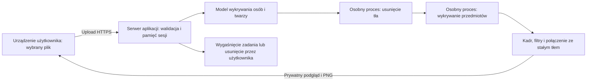

# Impact’27 — README do polityki prywatności, regulaminu i wdrożenia

Stan opisu: **12 października 2026 r.** Podstawa techniczna: kod wersji [`086c1d6`](https://github.com/PrzeBeetohoven22/Impact-image-modifier/tree/086c1d620f5220e5e0403cee403957b33c5d362a).

Dokument jest dokumentacją projektu dla właściciela narzędzia, osoby przygotowującej regulamin i politykę prywatności oraz zespołu wdrożeniowego. Opisuje fakty wynikające z kodu i decyzje potrzebne przed udostępnieniem narzędzia. Nie zastępuje zatwierdzonego regulaminu ani polityki prywatności. Obecny projekt działa jako wersja do testów w Codespaces; docelowy hosting i jego warunki nie zostały potwierdzone. Założenia odbiorców oraz pozostawienie pustych pól organizacyjnych wynikają z odpowiedzi właściciela z 12 października 2026 r.

## 1. Informacje organizacyjne do uzupełnienia

| Informacja | Stan |
| --- | --- |
| Podmiot świadczący usługę / administrator danych: nazwa, adres, dane rejestrowe | |
| Kontakt do spraw prywatności i realizacji praw; kontakt IOD, jeżeli dotyczy | |
| Odbiorcy narzędzia | **Ustalone założenie: zaproszeni prelegenci przez indywidualne linki oraz wewnętrzny zespół Impact** |
| Docelowa domena, dostawca hostingu, region przetwarzania | **DO DECYZJI** |
| Dostawcy bramki dostępu, monitoringu, logów i ich podwykonawcy | **DO DECYZJI** |
| Podstawy prawne przetwarzania dla poszczególnych celów | **DO USTALENIA przez administratora** |
| Zasady dalszego użycia grafik przez organizatora, zakres praw do zdjęcia i wizerunku | **DO USTALENIA**; aplikacja sama nie publikuje ani nie przekazuje wyników organizatorowi |
| Retencja logów infrastruktury oraz ewentualnych zgłoszeń do pomocy | **DO USTALENIA** |
| Retencja docelowa zdjęć | **DO DECYZJI**. Obecny kod: wygaśnięcie zadania po 20 minutach; szczegóły w sekcji 5. Dłuższe przechowywanie wymaga osobnej zmiany |

Nie należy wpisywać do dokumentów publicznych domyślnej nazwy administratora, regionu UE, podstawy prawnej ani gwarancji braku transferów poza EOG bez potwierdzenia tych informacji. Nazwa marki Impact’27 nie identyfikuje sama w sobie podmiotu prawnego.

Pola podmiotu i kontaktu celowo pozostawiono puste. Pozostałe oznaczenia „do decyzji” opisują otwarte ustalenia projektu, a nie przeszkodę w korzystaniu z tej dokumentacji.

### Docelowe grupy użytkowników i dostęp

- **Zaproszony prelegent:** otrzymuje indywidualny link i przygotowuje swoje zdjęcie. Mechanizm wydawania, ważności i unieważniania zaproszeń trzeba dopiero wybrać i wdrożyć; obecny losowy adres zadania nie pełni tej funkcji.
- **Wewnętrzny zespół Impact:** korzysta z narzędzia w zakresie przyznanych uprawnień. Uwierzytelnianie zespołu i ewentualny wgląd w zadania innych osób wymagają osobnej decyzji; obecny kod udostępnia zdjęcia wyłącznie sesji, która je wgrała.

Zadaniem docelowej kontroli dostępu będzie obsługa obu grup. W dokumentacji nie przyjęto ogólnodostępnego, anonimowego uploadu jako wariantu docelowego.

## 2. Cel i zakres usługi

Narzędzie przygotowuje pojedyncze zdjęcie prelegenta w identyfikacji wizualnej Impact’27. Użytkownik wybiera własny plik, generuje podgląd, dostosowuje kadr i pobiera gotowy PNG na swoje urządzenie.

| Funkcja | Obecny stan |
| --- | --- |
| Upload JPEG, PNG lub WebP | Dostępny; zdjęcia pionowe, poziome i kwadratowe |
| Wykrywanie osób i twarzy | Lokalne modele; kilka wykrytych osób blokuje przetworzenie; brak wykrytej twarzy uruchamia przybliżony kadr |
| Usunięcie tła | Lokalny model tworzy maskę przezroczystości; gotowe wycięte PNG może pominąć ten etap |
| Kadrowanie | Proporcjonalne skalowanie i przycinanie; dwa suwaki wielkości i wysokości sylwetki; opcjonalny ręczny pomiar głowy |
| Filtry | Zatwierdzony preset z możliwością korekty; m.in. ograniczenie nasycenia i opcjonalne delikatne odszumienie |
| Tło | Stały gradient na białym płótnie; użytkownik nie zmienia go w obecnej wersji interfejsu |
| Wynik | PNG 1600 × 1200, sRGB, nieprzezroczyste płótno; nazwa `Impact'27 photo.png` |
| Wykrywanie dodatkowych przedmiotów | Podstawowa detekcja oraz dodatkowy lokalny model, m.in. do mikrofonów; możliwe pomyłki i przeoczenia |
| Odpowiedź na pytanie o retusz AI | Zapisywana tylko dla bieżącego zadania; **nie wykonuje retuszu i nie wysyła zdjęcia do AI API** |
| Generowanie paczek / ZIP | **Niewdrożone**; wcześniej omówiono możliwość rozbudowy |
| Historia, konto użytkownika, wysyłka e-mailem, publikacja grafiki | **Niewdrożone** |
| Integracja Canva | Kod opcjonalnego API istnieje; obecny frontend z niego nie korzysta. Nie jest potrzebna do PNG |

Usuwanie tła, detekcja i kadrowanie mogą wymagać kontroli użytkownika: szczególnie włosów, dłoni, obiektów trzymanych przy ciele oraz ciasno przyciętych zdjęć. Aplikacja nie odtwarza zasłoniętych fragmentów ciała, nie generuje twarzy ani brakującego ubioru. Przetwarzanie obejmuje też normalizację orientacji i przestrzeni barw, skalowanie oraz filtry, więc wynik nie jest pikselowo identyczny z oryginałem.

Wartości bazowe filtrów: temperatura 13, odcień 0, jasność −8, kontrast −12, światła 3, cienie 6, biel −15, czerń 0, jaskrawość 15, nasycenie −63, ostrość 20. Odwrócenie i odszumianie są domyślnie wyłączone. Lokalny algorytm nie gwarantuje identycznego wyniku jak filtry Canva.

## 3. Gdzie i jak przetwarzane są zdjęcia

**„Lokalnie” oznacza na serwerze, na którym uruchomiono aplikację.** Zdjęcie opuszcza urządzenie użytkownika podczas uploadu. Przetwarzanie modeli nie odbywa się w całości w przeglądarce.



HTTPS w schemacie jest wymaganiem docelowego wdrożenia. Sam Node nasłuchuje HTTP; szyfrowanie połączenia użytkownika zapewnia Codespaces albo docelowy hosting / reverse proxy.

1. Wybrany plik i jego nazwa są dostępne w pamięci strony. Wybór pliku nie uruchamia uploadu; wysyłka następuje po kliknięciu generowania.
2. Serwer otrzymuje plik, sprawdza rzeczywisty format, rozmiar, liczbę pikseli i brak animacji. Normalizuje orientację EXIF i przestrzeń barw, tworząc roboczy PNG.
3. Model Human / BlazeFace + CenterNet wykrywa twarze, liczbę osób i podstawowe przedmioty. Nie włączono rozpoznawania tożsamości, opisów twarzy ani analizy emocji.
4. Model IMG.LY / ISNet usuwa tło. Jego maska alfa jest nakładana na znormalizowane źródło; model nie regeneruje twarzy.
5. OWL-ViT, jeśli jego wagi są zainstalowane, wykrywa możliwe dodatkowe przedmioty. ISNet i OWL-ViT działają w różnych procesach systemowych. Zdjęcia są przekazywane między nimi w pamięci przez IPC.
6. Serwer komponuje podgląd i wynik. API udostępnia je wyłącznie sesji, do której należy zadanie.
7. Pobranie zapisuje PNG na urządzeniu użytkownika. Aplikacja nie kontroluje późniejszego przechowywania ani publikacji tej kopii.

W podstawowym przepływie zdjęcia nie są wysyłane do OpenAI, Hugging Face, Canva ani dostawców bibliotek. Kod używa modeli do wnioskowania i nie zawiera procesu trenowania lub aktualizowania wag na zdjęciach użytkowników. Nie prowadzi automatycznej identyfikacji osób. Prawną ocenę przetwarzania zdjęć i danych związanych z twarzą należy oprzeć na faktycznym celu usługi, a nie na samym użyciu słowa „AI”.

## 4. Kategorie danych i miejsca ich występowania

| Dane | Cel | Miejsce / zakres |
| --- | --- | --- |
| Zdjęcie wejściowe, wizerunek, elementy otoczenia i ewentualne informacje widoczne na zdjęciu | Wykonanie zamówionego przetworzenia | Upload do serwera, normalizowane źródło w RAM; kopie robocze w procesach modeli |
| Metadane źródła, np. EXIF/GPS, oraz oryginalna nazwa pliku | Odczyt pliku i orientacji; nazwa jest częścią żądania uploadu | Serwer otrzymuje je wraz z uploadem. Nazwa nie jest zapisywana w obiekcie zadania; metadane EXIF/GPS nie są kopiowane do generowanego PNG |
| Wycięta sylwetka i maska | Kadrowanie, filtry i podgląd | RAM serwera i procesów roboczych |
| PNG z tłem i przezroczysta warstwa wynikowej sylwetki | Podgląd, pobranie; warstwa jest tworzona także przy wyłączonej Canva | RAM zadania; pobrany PNG również na urządzeniu użytkownika |
| Liczba osób, prostokąty twarzy, pomiar głowy, kadr i ustawienia filtrów | Dopasowanie kompozycji | RAM zadania; część informacji zwracana do przeglądarki |
| Etykiety przedmiotów, współrzędne i ocena pewności detektora | Komunikat o możliwym dodatkowym obiekcie | RAM zadania i podgląd w przeglądarce |
| Odpowiedź `accepted` / `declined` na pytanie o retusz | Zachowanie odpowiedzi w bieżącym zadaniu | RAM zadania; bez trwałego rejestru zgód |
| Losowy identyfikator sesji, identyfikatory zadań, daty wygaśnięcia, statusy błędów | Prywatny dostęp do podglądu i obsługa zadania | Cookie oraz RAM serwera / stan strony |
| IP, nagłówki HTTP, dane urządzenia i przeglądarki | Transport połączenia i ewentualna ochrona lub diagnostyka | Widoczne dla infrastruktury; zakres zapisywania i retencja zależą od hostingu i bramki dostępu |
| Dane konta lub adres e-mail z przyszłej bramki dostępu | Kontrola uprawnienia do korzystania | **Nie są obecnie zbierane przez formularz aplikacji**; wymagają opisu wybranego rozwiązania |

Interfejs nie pyta o imię, nazwisko, e-mail ani telefon. Zdjęcie i jego nazwa mogą jednak zawierać takie informacje. Brak formularza kontaktowego nie oznacza braku przetwarzania danych osobowych.

Kod aplikacji nie zapisuje zdjęć do bazy danych, katalogu uploadów ani magazynu obiektowego. Nie ma reklam, analityki marketingowej ani zewnętrznego CDN fontów; Raleway i Barlow Condensed są serwowane z aplikacji. Podczas przeglądu nie znaleziono użycia `localStorage`, `sessionStorage` ani IndexedDB do zdjęć lub zadań.

## 5. Retencja i usuwanie — dokładne znaczenie 20 minut

| Element | Obecne zachowanie |
| --- | --- |
| Dostępność zadania w API | Wygasa 20 minut po utworzeniu zadania. Korekty kadru i pobieranie nie przedłużają jego terminu |
| Porządkowanie pamięci sesji | Co 30 sekund aplikacja usuwa wygasłe wpisy. Wpis może pozostawać w strukturach pamięci do kolejnego cyklu porządkowania |
| Sesja serwera | Usuwana po 20 minutach bez żądania do API, sprawdzane co 30 sekund. Odpytanie statusu podczas przetwarzania jest aktywnością |
| Źródło robocze | Referencja jest zwalniana po przygotowaniu sylwetki i pomiaru głowy albo w obsłudze błędu. Przy odrzuceniu za kilka osób źródło może pozostać w zadaniu do usunięcia lub wygaśnięcia |
| „Usuń zdjęcie” | Usuwa zadanie z sesji i blokuje jego dostęp przez API. Usuwa dane tego zadania, a nie wszystkie dane przeglądarki, logi hostingu czy kopie użytkownika |
| Wygenerowanie następnego zdjęcia w tej samej karcie | Frontend usuwa poprzednie zadanie przed wysłaniem nowego. Sam wybór kolejnego pliku nie wykonuje tej operacji |
| Operacja już uruchomiona w modelu | Usunięcie zadania oznacza je jako anulowane, ale nie przerywa natychmiast obliczenia natywnego. Kopie robocze mogą pozostawać do jego zakończenia albo limitu czasu procesu, obecnie 120 sekund na wywołanie modelu |
| Restart / zatrzymanie aplikacji | Usuwa pamięć sesji i zadań; procesy pomocnicze są zamykane |
| Plik wybrany w przeglądarce | Może pozostać w pamięci strony także po przycisku „Usuń zdjęcie”; obecny frontend nie czyści wtedy pola wyboru pliku. Zwolnienie zależy m.in. od wyboru innego pliku, przeładowania lub zamknięcia strony |
| Pobrany PNG i oryginał użytkownika | Pozostają na urządzeniu według decyzji użytkownika; limit serwera ich nie obejmuje |
| Logi infrastruktury, kopie zapasowe, snapshoty RAM, swap i zrzuty awarii | **Nieustalone**; wymagają konfiguracji i potwierdzenia przez dostawcę wdrożenia |

Usunięcie referencji w programie nie jest gwarancją natychmiastowego wyzerowania każdego bajtu RAM. Zwalnianie pamięci zależy też od środowiska wykonawczego i bibliotek. Nie należy obiecywać „wszystkie kopie są bezpowrotnie usuwane dokładnie po 20 minutach”. Aktualna, precyzyjna deklaracja dotyczy wygaśnięcia dostępu i usuwania wpisów zgodnie z powyższymi zasadami.

Zamknięcie karty nie wysyła automatycznie żądania usunięcia zadania. Nie przedłuża ono jednak terminu jego wygaśnięcia. Nie ma archiwum historii ani funkcji odzyskania wyniku po restarcie.

## 6. Cookies i urządzenie użytkownika

| Parametr | Wartość wynikająca z kodu |
| --- | --- |
| Nazwa | `impact_session` |
| Zawartość / cel | Losowy identyfikator z podpisem; przypisanie zadań do sesji. Bez zdjęcia ani danych kontaktowych w cookie |
| Czas cookie | `Max-Age` 20 minut od ustawienia. Cookie nie jest odnawiane przy każdym żądaniu, choć czas bezczynności sesji serwera jest aktualizowany |
| `HttpOnly` | Tak |
| `SameSite` | `Lax` |
| `Secure` | Tak, gdy `APP_ORIGIN` zaczyna się od `https:`; docelowe wdrożenie musi mieć tę zmienną ustawioną prawidłowo |
| Podpis | Domyślnie losowy klucz dla uruchomienia procesu. Restart unieważnia dotychczasowe sesje; nie jest to szyfrowanie zdjęć |

Zablokowanie lub usunięcie cookie może spowodować utratę dostępu do bieżącego zadania. W przeglądarce powstają również tymczasowe adresy `blob:` dla pliku i pobierania; adres Blob wyniku jest zwalniany po około 60 sekundach, co nie usuwa pobranego pliku.

Nie ma obecnie banera zarządzania zgodami cookies. Administrator powinien opisać techniczną konieczność cookie i potwierdzić właściwe obowiązki informacyjne. Ewentualne cookies GitHub/Codespaces, bramki logowania, hostingu lub przyszłej analityki wymagają osobnej inwentaryzacji.

## 7. Dostawcy i ruch sieciowy

| Komponent / dostawca | Kiedy występuje | Czy zdjęcie jest wysyłane? |
| --- | --- | --- |
| Hosting aplikacji i reverse proxy | Każdy upload, podgląd i pobranie | Tak, w ramach świadczenia usługi na serwerze; region i dostęp administratorów hostingu trzeba potwierdzić |
| GitHub / Codespaces | Obecna ścieżka testów, przechowywanie kodu i uruchomienie serwera | W Codespaces zdjęcie trafia do uruchomionej tam aplikacji. Kod nie zapisuje zdjęć do Git ani repozytorium |
| Rejestr npm i infrastruktura pobierania paczek | Instalacja zależności i części modeli | Nie w podstawowym przepływie zdjęć |
| Hugging Face i CDN `*.hf.co`, `*.xethub.hf.co` | Instalacja dodatkowych wag OWL-ViT | Nie; pobierane są wagi, nie fotografie użytkowników |
| IMG.LY, Human, Transformers.js, Sharp | Biblioteki i modele pracujące na serwerze | Podstawowy pipeline nie wywołuje ich zewnętrznych usług przetwarzania zdjęć |
| OpenAI | Brak integracji retuszu lub generowania obrazów w obecnym kodzie | Nie |
| Canva | Tylko po skonfigurowaniu i świadomym wywołaniu opcjonalnego API | Tak, warstwa sylwetki jest przesyłana i zapisywana w Canva; szczegóły poniżej |

Zależności i wagi wymagają dostępu sieciowego podczas instalacji. Po instalacji podstawowe przetwarzanie działa bez zewnętrznego API zdjęć. Do uruchomienia aplikacji nie jest potrzebny klucz OpenAI ani Canva.

Przed produkcją należy ustalić listę podmiotów przetwarzających, odpowiednie umowy powierzenia, regiony, podwykonawców i ewentualne transfery poza EOG. Same źródła kodu bibliotek nie przesądzają, kto jest procesorem danych przy wybranym hostingu.

### Opcjonalna Canva — osobny wariant przepływu

Obecny frontend nie pokazuje przycisków Canva. Jeżeli integracja zostanie uruchomiona, użytkownik przechodzi OAuth z PKCE, a serwer przechowuje access/refresh tokeny w pamięci sesji. Wysłana zostaje przezroczysta warstwa PNG, powstają asset i projekt, a aplikacja pobiera eksport. Retencja Canva jest odrębna; „Usuń zdjęcie”, rozłączenie konta i restart aplikacji nie usuwają zdalnych assetów ani projektów. Tokeny lokalne nie są trwałą bazą danych kont.

Aktywacja tego wariantu wymaga aktualizacji dokumentów prywatności, informacji dla użytkownika, konfiguracji sekretów i potwierdzenia działania oraz uprawnień konta. Szczegóły: [CANVA.md](CANVA.md).

## 8. Zabezpieczenia istniejące i wymagania produkcyjne

| Obszar | Jest w kodzie | Do wykonania przy wdrożeniu |
| --- | --- | --- |
| Dostęp do zdjęć | Zadania są przypisane do podpisanej sesji; obca sesja nie otrzyma podglądu | Wybrać uwierzytelnianie i uprawnienia do korzystania z całej usługi; cookie nie jest kontem ani weryfikacją tożsamości |
| Szyfrowanie połączeń | Obsługa `Secure` cookie przy prawidłowym `APP_ORIGIN` | HTTPS przez hosting / reverse proxy, poprawna domena i ochrona także API oraz pobierania |
| Upload | Jeden plik na żądanie; walidacja MIME i dekodowanego formatu; limity rozmiaru i pikseli | Limity żądań i jednoczesnych uploadów na bramce; kontrola wykorzystania CPU/RAM |
| Żądania z innych stron | Kontrola `Origin` i `Sec-Fetch-Site`; ograniczony wyjątek dla proxy Codespaces | Sprawdzić zachowanie docelowego proxy. Kontrola origin nie zastępuje logowania ani ochrony przed przeciążeniem |
| Odpowiedzi API | `Cache-Control: no-store`; nagłówki Helmet i CSP | Wyłączyć cache / zapisywanie treści uploadów, podglądów i pobrań w CDN, proxy i monitoringu |
| Awaria modelu | Osobne procesy modeli, timeout 120 sekund, odtworzenie po awarii | Monitorować pamięć całego hosta, restarty i dostępność; izolacja nie jest gwarancją dostępności całej infrastruktury |
| Logowanie | Serwer loguje start i awarię procesu modelu; brak własnego rejestru treści uploadów | Ustalić retencję logów, dostęp do nich i maskowanie cookie, tokenów, treści żądań oraz ewentualnych danych w nazwach plików |
| Dysk i kopie | Aplikacja nie zapisuje uploadów w zwykłym przepływie | Zweryfikować buforowanie request body na dysku przez proxy, swap, core dumpy i snapshoty. Nie deklarować braku kopii infrastruktury bez tej kontroli |
| Obsługa użytkownika | Błędy i usunięcie własnego zadania | Ustalić kontakt, obsługę reklamacji, żądań dotyczących danych i incydentów |

Brak obecnie: logowania użytkowników w aplikacji, trwałego audytu zgód, ograniczeń częstotliwości według użytkownika/IP, panelu administracyjnego, trwałej historii i replikacji sesji. Przed dostępem publicznym trzeba rozstrzygnąć te potrzeby i odpowiednio zabezpieczyć bramkę wejściową. Są to wymagania wdrożenia, nie funkcje wdrożone przez ten dokument.

### Komunikat o retuszu i zgoda

Obecny komunikat brzmi: „WYKRYTO OBIEKT NIE BĘDĄCY SYLWETKĄ, CZY ZGADASZ SIĘ NA RETUSZ PRZY UŻYCIU AI?”. Interfejs wyjaśnia również, że ta wersja nie wykonuje retuszu. Zapis `accepted` / `declined` nie stanowi wbudowanej zgody na przetwarzanie danych, publikację wizerunku ani przyszłe przekazanie zdjęcia zewnętrznemu dostawcy.

Przed produkcją należy zatwierdzić copy, aby nie sugerowało dostępnej usługi retuszu. Jeśli retusz zostanie dodany, potrzebne będą osobno: opis rzeczywistej operacji i dostawcy, informacja o przekazaniu danych, podstawa prawna, zasady dokumentowania wyboru i jego zakres. Obecnych odpowiedzi nie wolno traktować jako bezterminowej zgody na późniejszą usługę.

## 9. Założenia do regulaminu i polityki prywatności

### Regulamin korzystania — zakres do opisania

| Temat | Materiał / decyzja |
| --- | --- |
| Usługodawca i kontakt | Uzupełnić podmiot oraz kontakt do wsparcia i reklamacji |
| Uprawnieni użytkownicy | Zaproszeni prelegenci przez indywidualne linki oraz wewnętrzny zespół Impact. Ustalić wydawanie i wygaszanie dostępu, uprawnienia zespołu oraz odpłatność |
| Prawa do materiału | Ustalić wymóg uprawnienia do wykorzystania i przetworzenia zdjęcia oraz wizerunku; samo przesłanie pliku nie rozstrzyga praw autora zdjęcia ani osoby przedstawionej |
| Dozwolony zakres materiału | Zdjęcie jednej osoby; ustalić zasady dla osób trzecich i małoletnich oraz materiałów zawierających dodatkowe dane |
| Zakres wykonanej usługi | Usunięcie tła, kadrowanie, filtry, PNG. Brak gwarancji perfekcyjnej maski, wykrycia każdego obiektu lub odtworzenia uciętych części zdjęcia |
| Odpowiedzialność za zatwierdzenie | Opisać kontrolę wyniku przez użytkownika przed pobraniem i publikacją |
| Dostępność i wygaśnięcie | Tymczasowe zadania, utrata po restarcie, konieczność pobrania wyniku; tryb utrzymania i zgłoszeń do ustalenia |
| Dalsza publikacja | Oddzielić wykonanie grafiki od zgody na publikację i użycie w materiałach organizatora. Narzędzie samo nie publikuje |
| Zmiany i zakończenie usługi | Ustalić zasady zmian, zamknięcia dostępu i powiadamiania |

### Polityka prywatności — zakres do uzupełnienia

Osoba przygotowująca dokument powinna użyć inwentaryzacji z sekcji 3–7 oraz uzupełnić: administratora i kontakt; cele i właściwe podstawy prawne; źródła i kategorie danych; odbiorców oraz podwykonawców; lokalizacje i transfery; osobne okresy przechowywania zdjęć, cookies i logów; charakter podania danych; prawa osób i sposób ich realizacji; prawo skargi do właściwego organu; cookies; zasady zmiany polityki.

Ustalenie podstawy prawnej wymaga decyzji organizatora dla każdego celu: wykonania grafiki, ochrony usługi, ewentualnego konta i dalszego wykorzystania wizerunku. Kod nie wybiera podstawy prawnej i nie zbiera zgody regulaminowej ani potwierdzenia praw do zdjęcia. Rozstrzygnięcie obowiązków RODO, w tym potrzeby oceny skutków przetwarzania, powinno uwzględniać docelową skalę, dostęp i faktyczne funkcje.

Obecna analiza twarzy służy policzeniu osób i dobraniu kadru; nie tworzy wzorców do jednoznacznej identyfikacji ani rankingów osób. Nie należy opisywać jej jako rozpoznawania tożsamości czy oceny emocji. Nie ustalono innych celów użycia danych ani zewnętrznych decyzji podejmowanych na podstawie analizy.

### Przykładowy opis działania do wykorzystania w informacji dla użytkownika

> Narzędzie przygotowuje zdjęcie w oprawie Impact’27. Po uruchomieniu generowania zdjęcie jest przesyłane na serwer usługi, gdzie lokalne modele wykrywają sylwetkę i twarz, usuwają tło oraz pomagają dopasować kadr. Obraz jest następnie kadrowany i przetwarzany filtrami. Podstawowa wersja nie przesyła zdjęć do OpenAI ani zewnętrznych usług retuszu i nie publikuje wyniku. Gotowy PNG pobierasz na własne urządzenie. Zadanie wygasa po 20 minutach; możesz wcześniej usunąć je z sesji przyciskiem „Usuń zdjęcie”. Szczegóły retencji serwera, cookies oraz logów infrastruktury opisuje polityka prywatności usługi.

To opis techniczny do redakcji, nie kompletna klauzula informacyjna. Przed publikacją trzeba dodać dane administratora oraz pozostałe informacje dla wybranego wdrożenia.

## 10. Założenia i procedura wdrożenia

### Platforma i parametry startowe

| Element | Założenie |
| --- | --- |
| Runtime | Node.js 24 i npm; referencyjny kontener Linux x64 |
| Architektura | Jedna usługa Node serwująca frontend React/Vite i API pod jednym originem; osobne procesy dwóch modeli startują automatycznie |
| Instancje | Jedna instancja aplikacji i jeden proces API na start. Kilka instancji wymaga zaprojektowania routingu sesji lub współdzielonego stanu; obecny kod nie zapewnia tego |
| Zasoby | Punkt startowy zgodny z Codespaces: 2 vCPU / 8 GB RAM. To konfiguracja do weryfikacji obciążeniem, a nie gwarantowana pojemność produkcyjna |
| GPU / zewnętrzny AI API | Niewymagane; przetwarzanie CPU/WASM |
| Przechowywanie | Sesje i fotografie w RAM; na dysku kod, biblioteki, gradient i wagi modeli. Brak magazynu zdjęć ani bazy danych |
| Katalog roboczy | Główny katalog repozytorium; zawiera `dist/`, `assets/`, `node_modules/` i `.runtime/objects/`, jeśli potrzebna jest rozszerzona detekcja |
| `HOST` | Docelowo `0.0.0.0` za kontrolowaną bramką / proxy |
| `PORT` | Port przekazany przez hosting; domyślnie 3001 |
| `APP_ORIGIN` | Dokładny publiczny origin HTTPS, bez końcowego ukośnika |
| Kontrola dostępu | Indywidualne zaproszenia dla prelegentów oraz uwierzytelniony dostęp zespołu; konkretny mechanizm, ważność linków i uprawnienia do decyzji |
| Sekrety | Podstawowy wariant nie wymaga Canva ani OpenAI. Konfiguracja bramki dostępu może mieć własne sekrety; przechowywać w ustawieniach hostingu |
| Health check | Dopasować z bramką dostęp; `/api/health` tworzy sesję. Częste anonimowe próby tego endpointu mogą zużyć limit sesji. `/` zwraca UI i nie potwierdza gotowości modeli |

### Limity istniejące w kodzie

| Limit | Wartość |
| --- | --- |
| Plik wejściowy | 20 MiB = 20 971 520 bajtów; interfejs opisuje go jako 20 MB |
| Rozdzielczość wejściowa | Maksymalnie 40 000 000 pikseli, minimum 300 px na krótszym boku |
| Liczba plików w żądaniu | 1; animacje i obrazy wielostronicowe odrzucane |
| Operacje aktywne i oczekujące w kolejce | Maksymalnie 3; wspólna kolejka wykonuje zadania kolejno, nie trzy równolegle |
| Zadania na sesję | Maksymalnie 5 zachowanych zadań |
| Zachowane zadania globalnie | Maksymalnie 20 |
| Sesje w pamięci | Maksymalnie 50 |
| Wywołanie natywnego modelu | Timeout 120 sekund, osobno dla każdego modelu; brak gwarantowanego czasu całego zadania |

Limity zadaniowe nie zastępują limitów uploadów na wejściu. Plik 40 MP wymaga znacznie więcej pamięci po dekodowaniu niż jego rozmiar skompresowany. Równoczesne przyjmowanie i walidacja plików wymagają osobnego testu oraz limitów na proxy.

### Instalacja i start poza Codespaces

Poniższe polecenia wykonuje osoba wdrażająca w katalogu repozytorium, w środowisku Node 24:

```bash
npm_config_onnxruntime_node_install_cuda=skip npm ci --include=dev --no-audit --no-fund
npm run setup:objects
npm run build
npm start
```

`HOST`, `PORT` i `APP_ORIGIN` należy wcześniej ustawić w konfiguracji usługi. Flaga CUDA pomija zbędną instalację GPU. Build potrzebuje zależności developerskich. Samo skopiowanie katalogu `dist/` nie wystarczy: serwer korzysta też z lokalnych modeli, paczek i gradientu. Jeżeli wymagane jest wykrywanie mikrofonów, sukces instalacji OWL-ViT i próba inferencji są warunkiem przyjęcia wdrożenia. Bez modelu aplikacja nadal eksportuje PNG, ale zgłasza ograniczoną detekcję.

Szczegóły prywatnych testów: [instrukcja Codespaces](PIERWSZE-URUCHOMIENIE.html). Szczegóły hostingu: [TEST-DEPLOYMENT.md](TEST-DEPLOYMENT.md). Propozycja dostawcy w tym drugim dokumencie nie oznacza jego wyboru ani potwierdzenia regionu.

### Warunki przyjęcia wdrożenia

- [ ] Uzupełniono administratora, kontakt, odbiorców narzędzia, cele i podstawy prawne.
- [ ] Zatwierdzono regulamin, politykę prywatności oraz informację widoczną przed uploadem; ustalono prawa do zdjęć i dalszego użycia wizerunku.
- [ ] Wybrano hosting, region, dostęp operatorów, podwykonawców, umowy powierzenia i zasady ewentualnych transferów.
- [ ] Wdrożono wybraną kontrolę dostępu oraz ochronę uploadów i API przed przeciążeniem.
- [ ] Sprawdzono HTTPS, `APP_ORIGIN`, cookie, izolację sesji oraz cache prywatnych odpowiedzi w rzeczywistym proxy.
- [ ] Ustalono retencję i zakres logów, wyłączono przechwytywanie treści zdjęć i sekretów, zweryfikowano bufory proxy, zrzuty awarii oraz snapshoty.
- [ ] Przetestowano modele, odrzucanie plików, błędy, usuwanie, wygaśnięcie, restart i pobieranie pod docelowym URL.
- [ ] Sprawdzono kilka różnych portretów i co najmniej trzy kolejne zdjęcia z tłem w tej samej aplikacji; test samych przezroczystych PNG nie sprawdza obu modeli ONNX.
- [ ] Zmierzono czasy, szczytowe RAM i zachowanie przy równoczesnych żądaniach; ustalono limit użytkowników i sposób monitorowania.
- [ ] Zatwierdzono copy dotyczące retuszu, aby odpowiadało dostępnej funkcji.
- [ ] Potwierdzono warunki licencji bibliotek, wag modeli i materiałów marki.

Przydatne sprawdzenia techniczne: `npm run lint`, `npm run typecheck`, `npm test`, `npm run check:models`, `npm run check:objects`, `npm run build`, `npm run test:browser` oraz `npm run check:pipeline -- sciezka-do-zdjecia.jpg`. Diagnostykę prowadzić na zdjęciach dopuszczonych do tego celu; nie kopiować realnych uploadów do repozytorium.

**Wyjątek diagnostyczny:** `check:models` z argumentem zdjęcia zapisuje wycięty przykład do `/tmp/impact-isolated-test.png` i drukuje wyniki analizy. `canva:poc` zapisuje plik eksportu pod wskazaną ścieżką. Te skrypty nie należą do zwykłego przepływu użytkownika; operator odpowiada za usunięcie plików i właściwą retencję logów testowych.

## 11. Licencje i materiały marki

| Składnik | Co potwierdzono / co sprawdzić |
| --- | --- |
| IMG.LY background-removal-node 1.4.5 | Dystrybucja zawiera warunki AGPL. Przed udostępnieniem usługi ustalić spełnienie warunków, komercyjną licencję lub inny provider |
| Human 3.3.6 | Biblioteka MIT; uwzględnić odrębne informacje o dołączonych modelach |
| Transformers.js 3.8.1 i Sharp 0.35.5 | Biblioteki Apache-2.0; zachować wymagane informacje o licencjach |
| OWL-ViT | Wagi `Xenova/owlvit-base-patch32`, bazowy model Google OWL-ViT; rewizja przypięta i sumy kontrolne zweryfikowane. Warunki wag potwierdzić osobno od licencji biblioteki Transformers.js |
| Raleway / Barlow Condensed | Lokalne fonty na SIL OFL 1.1; teksty licencji w `src/client/fonts/` |
| Gradient i marka Impact’27 | Materiał wybrany przez właściciela; uprawnienia do zastosowania i publicznej dystrybucji potwierdza właściciel |
| Kod aplikacji | W repozytorium nie ma odrębnej licencji całego projektu. Właściciel powinien ustalić prawa i zasady jego udostępniania |

## 12. Źródła faktów i zasady aktualizacji dokumentu

| Obszar | Pliki |
| --- | --- |
| Upload, sesje, cookie, kolejka, TTL, usuwanie, dostęp do PNG | [`src/server/app.ts`](../src/server/app.ts) |
| Walidacja, normalizacja metadanych, kompozycja i eksport | [`src/server/images.ts`](../src/server/images.ts) |
| Analiza twarzy i osób, wybór sposobu usunięcia tła | [`src/server/providers.ts`](../src/server/providers.ts) |
| Procesy modeli, timeout i transport w pamięci | [`native-process.ts`](../src/server/native-process.ts), [`native-worker.ts`](../src/server/native-worker.ts), [`native-models.ts`](../src/server/native-models.ts) |
| Obiekty i ograniczona detekcja | [`src/server/objects.ts`](../src/server/objects.ts), [opis detekcji](OBIEKTY.md) |
| Formularz, stan przeglądarki, pobranie, komunikat i decyzja | [`src/client/main.tsx`](../src/client/main.tsx) |
| Ustawienia, format i nazwa wyniku | [`src/shared/config.ts`](../src/shared/config.ts) |
| Start i zmienne środowiska | [`src/server/index.ts`](../src/server/index.ts), [`.env.example`](../.env.example), [`.devcontainer`](../.devcontainer/devcontainer.json) |
| Opcjonalne przekazanie do Canva | [`src/server/canva.ts`](../src/server/canva.ts), [CANVA.md](CANVA.md) |
| Pobieranie wag i ich integralność | [`scripts/setup-objects.ts`](../scripts/setup-objects.ts) |

Dokument trzeba zaktualizować po zmianie hostingu, regionu, kontroli dostępu, retencji, logów, analityki, modelu lub dostawcy retuszu, aktywacji Canva, dodaniu paczek ZIP, historii albo automatycznego przekazywania wyników organizatorowi. Sam opis planowanej funkcji nie uprawnia do przedstawiania jej jako działającej.
